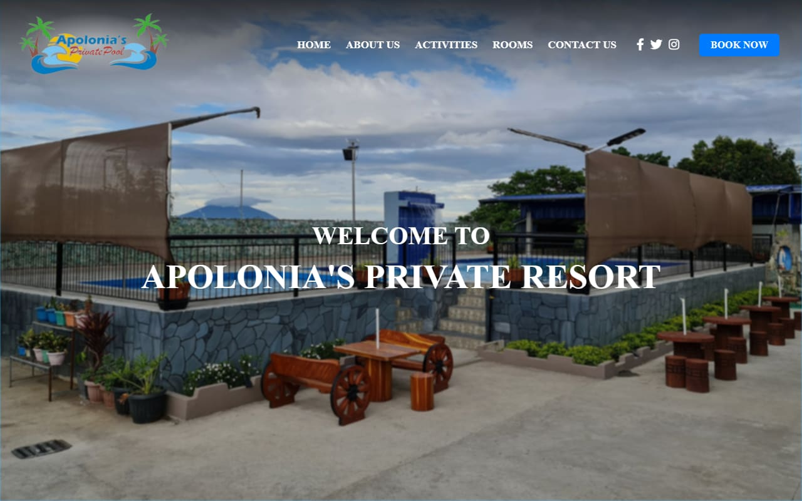
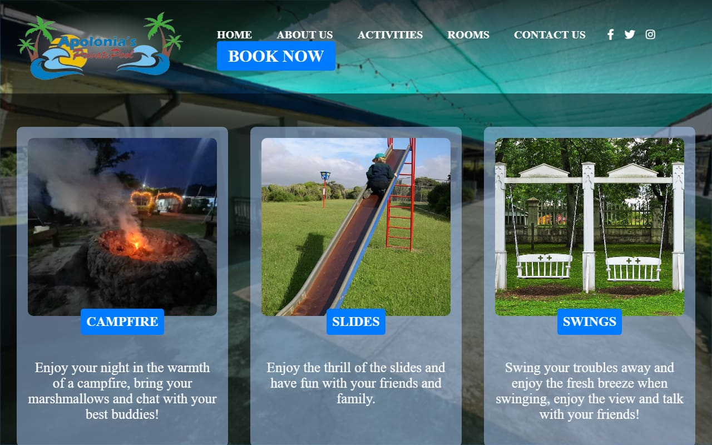
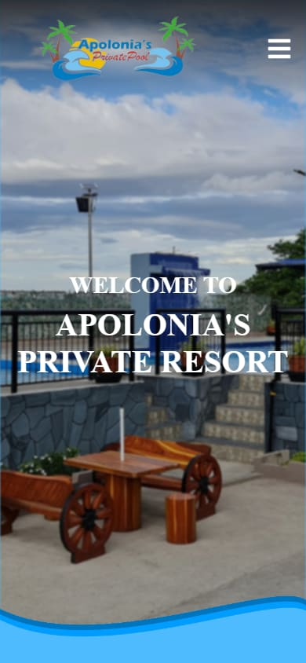

# Apolonia's Private Resort

A multi-page website for **Apolonia's Private Resort**, a family-run private pool resort in Barangay Cuayan, Angeles City, Philippines. It shows guests the resort's activities, rooms and rates, and how to book.

**Live site:** https://chompd.github.io/Apolonia-s-Private-Resort/



## Pages

| Page | What's on it |
| --- | --- |
| **Home** | Full-screen photo banner, a booking strip (date, package, guests) that fills in the contact form, the resort's story, an activities band, rooms, quick questions, the captioned video tour, a map and a closing quote |
| **About** | The resort's story, what makes it good for gatherings, and where to find it |
| **Activities** | Campfire, slides, swings, volleyball, karaoke and basketball, in alternating photo-and-text rows |
| **Rooms & Rates** | Room 1, Room 2, master bedroom, living room, kitchen and outside room, plus a rates menu and function hall info |
| **Contact** | An inquiry form (with package, preferred date and number of guests), the resort's email, Facebook and address, and an embedded Google Map |

## Design

A classic resort look: Playfair Display serif headlines with Montserrat for body text, teal and deep-teal accents on white and warm beige paper. Sections are separated by torn-paper edges, photos sit on offset teal blocks, and large faded words run down the side of some sections. The navigation stays at the top, with the links split around a centered logo.

## Features

- **Responsive layout** that adapts from phones to wide desktops (main breakpoints at 1180px, 960px and 640px), plus print styles.
- **Fixed header** with links split around a centered logo; it turns solid on scroll, and becomes a slide-in menu on phones and tablets (closes on Escape, link tap or tapping outside).
- **Booking strip** on the home page that carries the chosen date, package and guest count into the contact form.
- **Scroll animations:** sections fade in as they come into view, and are turned off for visitors who prefer reduced motion.
- **Captioned video:** the home page video has an English WebVTT caption track (`media/mimavideo.vtt`).
- **Embedded Google Map** on the Contact page.
- **Contact form opens a prefilled email** to the resort, after checking that name, email and message are filled in.
- **Accessible markup:** labelled form fields, real buttons for the menu, a skip link and visible focus outlines.

| Activities page | On a phone |
| --- | --- |
|  |  |

## Built with

- HTML5 and CSS3
- Vanilla JavaScript
- [Font Awesome](https://fontawesome.com/) icons
- Google Fonts (Playfair Display and Montserrat) and Google Maps embed
- Hosted on GitHub Pages

## Run it locally

No build step. Clone the repo and open `index.html` in a browser, or serve the folder:

```bash
git clone https://github.com/ChompD/Apolonia-s-Private-Resort.git
cd Apolonia-s-Private-Resort
python -m http.server 8000
```

Then go to http://localhost:8000.

## Project structure

```
├── index.html        Home
├── about.html        About
├── activities.html   Activities
├── rooms.html        Rooms & rates
├── contact.html      Contact form + map
├── style.css         All styles, including the responsive breakpoints
├── main.js           Menu, header, scroll animations and contact form
├── images/           Photos, logo and icons
├── videos/           Home page video
└── media/            Video captions (WebVTT)
```

## Notes

- The contact form has no backend; it opens the visitor's email app with the message ready to send to Apoloniasresort@gmail.com.
- The home page video is by [Mima Kristine and Kaiden](https://www.facebook.com/mommykristineandkaiden) and is credited on the page.

## Author

Designed and built by **Dexter Christian C. Toribio** ([@ChompD](https://github.com/ChompD)), 2024.
