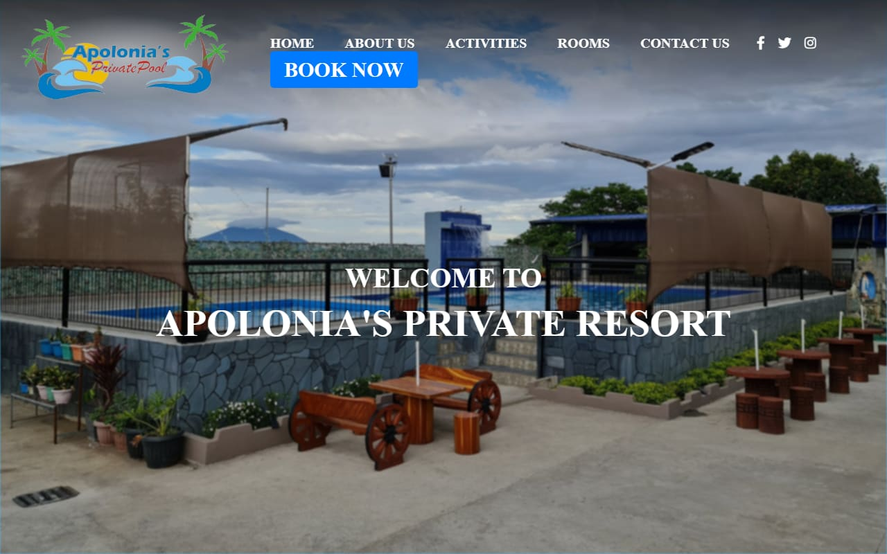
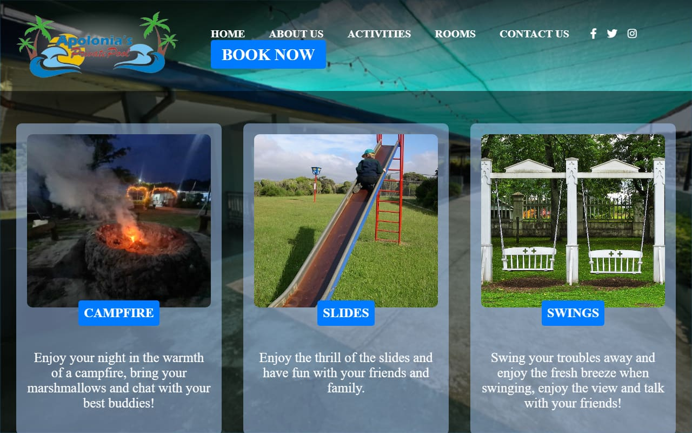
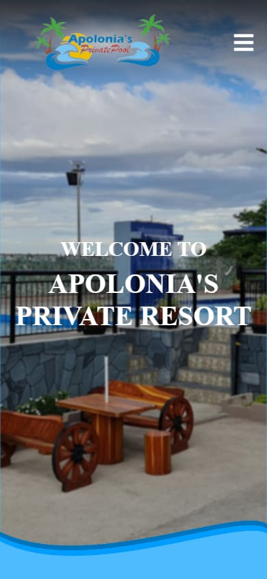

# Apolonia's Private Resort

A multi-page website for **Apolonia's Private Resort**, a family-run private pool resort in Barangay Cuayan, Angeles City, Philippines. It shows guests the resort's activities, rooms and rates, and how to book.

**Live site:** https://chompd.github.io/Apolonia-s-Private-Resort/



## Pages

| Page | What's on it |
| --- | --- |
| **Home** | Welcome banner, links to Activities, Rooms and About Us, and a resort video with English captions |
| **About Us** | The resort's history and an embedded Google Map of its location |
| **Activities** | Campfire, slides, swings, volleyball, karaoke and basketball, each with a photo |
| **Rooms** | Room 1, Room 2, master bedroom, living room, kitchen and outside room, plus a rates table for day swimming and overnight stays |
| **Contact Us** | An inquiry form (name, email, contact number, subject, message) and the resort's email |

## Features

- **Responsive layout** with breakpoints for phones (up to 750px), tablets (750–1024px) and desktops, plus print styles.
- **Hamburger menu on phones**, opened and closed with a few lines of JavaScript (`main.js`).
- **Captioned video:** the home page video has an English WebVTT caption track (`media/mimavideo.vtt`).
- **Embedded Google Map** on the About Us page.
- **Social links and a "Book Now" button** in the navigation bar on every page.

| Activities page | On a phone |
| --- | --- |
|  |  |

## Built with

- HTML5 and CSS3
- Vanilla JavaScript
- [Font Awesome](https://fontawesome.com/) icons
- Google Fonts and Google Maps embed
- Hosted on GitHub Pages

## Run it locally

No build step. Clone the repo and open `index.html` in a browser, or serve the folder:

```bash
git clone https://github.com/ChompD/Apolonia-s-Private-Resort.git
cd Apolonia-s-Private-Resort
python -m http.server 8000
```

Then go to http://localhost:8000.

## Project structure

```
├── index.html        Home
├── about.html        About Us + map
├── activities.html   Activities
├── rooms.html        Rooms + rates
├── contact.html      Contact form
├── style.css         All styles, including the responsive breakpoints
├── main.js           Phone menu
├── images/           Photos, logo and icons
├── videos/           Home page video
└── media/            Video captions (WebVTT)
```

## Notes

- The contact form is front-end only; it doesn't send messages yet.
- The Twitter and Instagram icons are placeholders; only the Facebook link points to the resort's page.
- The home page video is by [Mima Kristine and Kaiden](https://www.facebook.com/mommykristineandkaiden) and is credited on the page.

## Author

Designed and built by **Dexter Christian C. Toribio** ([@ChompD](https://github.com/ChompD)), 2024.
